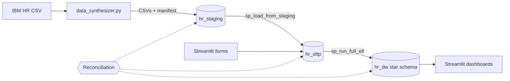

# Enterprise Employee Analytics & Data Warehouse System

An end-to-end HR analytics platform. It has:

- a Python data synthesizer
- a normalized MySQL application database (OLTP)
- a star-schema data warehouse with **Slowly Changing Dimension Type 2** history
- an object-oriented Python backend
- a Streamlit web app for data entry and interactive dashboards

Every stage is **reconciled** against the one before it and is **idempotent**, so it is safe to re-run.

*Rising Stars — Greenfield Mini-Project (Version 2)*

| Document | Read it for |
|---|---|
| **README.md** (this file) | What the project is, quick start, repository map |
| **[docs/SETUP.md](docs/SETUP.md)** | Installing, configuring, running every step, re-running, testing, deploying, troubleshooting |
| **[docs/EXPLANATION.md](docs/EXPLANATION.md)** | How it works and why: data synthesis, ER and star schema, SCD2, ETL, reconciliation, idempotency, OOP design |

---

## Introduction

The company is replacing disconnected legacy HR systems with one central, cloud-ready data warehouse. HR staff and executives use a **Streamlit** web app to:

1. **Onboard employees** and manage project assignments.
2. **Track changes** to an employee's department, role, level and salary over time. Old values are kept as history, not overwritten (SCD Type 2).
3. **Analyse the workforce** on dashboards built on a dimensional model: year-over-year performance, top performers per department (`DENSE_RANK()`), attrition risk and project bottlenecks.

The public **IBM HR Analytics Employee Attrition & Performance** dataset (1,470 employees, one point in time) is the starting point. A synthesizer scales it to **100,000 employees and 818,546 rows**, and generates the multi-year history a single snapshot lacks.

## What's inside

- **Data synthesizer.** pandas and Faker scale the data while keeping the IBM correlations. It engineers SCD2 history (transfers, promotions, salary revisions) and validates 22 invariants before writing anything. It then publishes the CSVs atomically with a checksum manifest.
- **Three MySQL schemas:**
  - `hr_staging`: raw CSV data with deliberate dirt
  - `hr_oltp`: 3NF system of record
  - `hr_dw`: star schema with surrogate keys and an SCD2 employee dimension
- **ETL in stored procedures.** CTEs and window functions clean and de-duplicate the data. Rows that can't be loaded are rejected with a reason, never silently dropped. Facts are joined to the employee version that was valid on the review date. The loads are transactional and serialised by a lock.
- **Reconciliation at every hop:**
  - CSV → staging: checksums, row counts, control totals
  - staging → OLTP: every key loaded or rejected, row fingerprints
  - OLTP → warehouse: counts, control totals, missing and orphan facts
  - SCD2 integrity: one current version, no gaps or overlaps

  That is 51 checks per full run, logged to `hr_dw.reconciliation_log`.
- **Idempotency everywhere.** Re-running any step changes nothing; a second ETL run writes 0 rows. App forms use request keys, so a double-click or retry writes once.
- **OOP backend.** A Singleton `DatabaseConnection` holds a connection pool. `Employee`, `Project` and `Review` entities validate their own data. Manager classes form the Data Access Layer, with error handling.
- **Streamlit app.** 7 pages: forms, Plotly dashboards, and an ETL & reconciliation console.
- **Diagrams.** Editable draw.io ER and dimensional models.

## Architecture



## Quick start

You need Python 3.10+ and MySQL 8.0+. Full details, including creating the MySQL user, are in [docs/SETUP.md](docs/SETUP.md).

```bash
pip install -r requirements.txt
```

```bash
cp .env.example .env
```

Then fill in your MySQL connection details in `.env`.

```bash
python scripts/data_synthesizer.py --fallback-base
```

(Put the IBM CSV in `data/raw/` and drop `--fallback-base` to use the real data.)

```bash
python scripts/setup_database.py
```

```bash
python scripts/load_staging.py
```

```bash
python scripts/run_etl.py
```

```bash
streamlit run streamlit_app.py
```

Each step ends by reconciling its output, and exits with code 1 if any check fails. Measured on 2026-11-06, the whole pipeline takes about 50 seconds, and every check passes. To re-check any time:

```bash
python scripts/reconcile.py
```

## Repository structure

```
.
├── README.md                     # overview (this file)
├── docs/
│   ├── SETUP.md                  # install, run, re-run, test, deploy, troubleshoot
│   └── EXPLANATION.md            # design, data model, SCD2, ETL, reconciliation, idempotency
├── requirements.txt
├── streamlit_app.py              # Streamlit entry point
├── app_pages/                    # one file per page (+ common.py helpers)
├── hr_analytics/                 # OOP backend
│   ├── config.py                 # settings from st.secrets or .env
│   ├── db_manager.py             # DatabaseConnection (Singleton + pool)
│   ├── models.py                 # Employee, Project, Review
│   ├── managers.py               # managers incl. ReconciliationManager, idempotency keys
│   └── etl.py                    # SqlScriptRunner, StagingLoader, CheckResult
├── scripts/
│   ├── data_synthesizer.py       # 1. generate + validate + publish data
│   ├── setup_database.py         # 2. create schemas/tables/procedures (non-destructive)
│   ├── load_staging.py           # 3. CSV -> staging -> OLTP, reconciled
│   ├── run_etl.py                # 4. OLTP -> warehouse, reconciled
│   └── reconcile.py              #    run reconciliation on its own
├── sql/
│   ├── 01_create_schemas.sql
│   ├── 02_staging_ddl.sql        # + load_batches, stg_rejects
│   ├── 03_oltp_ddl.sql           # + idempotency_keys
│   ├── 04_dw_ddl.sql             # + reconciliation_log
│   ├── 05_staging_to_oltp.sql    # cleaning procedure with rejects
│   ├── 06_dw_etl_procedures.sql  # dimensions, SCD2, facts, orchestration, lock
│   ├── 07_analytics_views.sql
│   ├── 08_reconciliation.sql     # sp_reconcile
│   └── 09_sample_queries.sql
├── diagrams/                     # editable .drawio ER + star schema
├── data/raw/                     # IBM CSV goes here (git-ignored)
├── data/synthetic/               # generated CSVs + _manifest.json (git-ignored)
└── tests/                        # unit tests + opt-in DB integration tests
```

## Status

| Item | State |
|---|---|
| Synthesizer, SQL, ETL, reconciliation, idempotency, OOP backend, Streamlit app, diagrams | Done. Verified end to end on MySQL |
| Tests | 33 passed with `RUN_DB_TESTS=1` (26 unit tests run without a database) |
| Real IBM CSV | Add it to `data/raw/`. The data currently in `data/synthetic/` was generated with `--fallback-base` |
| Streamlit Cloud deployment | Needs a hosted MySQL — see [docs/SETUP.md §11](docs/SETUP.md#11-deploying-to-streamlit-community-cloud) |
| Google Doc (from the brief) | Use [docs/EXPLANATION.md](docs/EXPLANATION.md) as its content |
